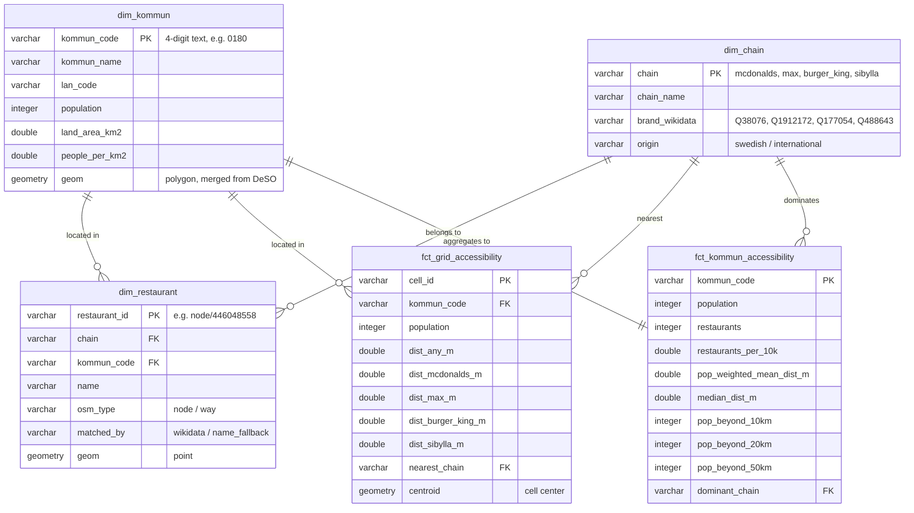
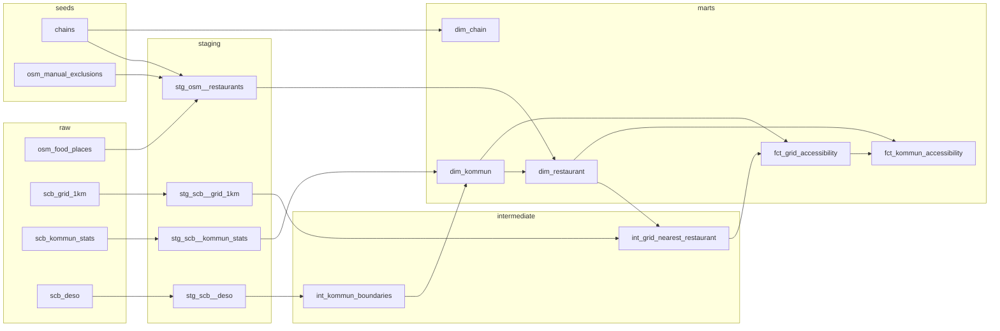

# Data model

> **Status (2026-10-27):** Staging for SCB sources and municipality boundaries is built ✅. Restaurants, seeds and marts are next 📋.

All geometries are **SWEREF 99 TM (EPSG:3006)** after staging. All distances are in meters.

## Overview – star schema in marts

The dashboard reads only from marts: two fact tables (different grain) sharing three dimensions.

| Table                      | Grain (one row per)                | ~Rows   | Answers    |
| -------------------------- | ---------------------------------- | ------- | ---------- |
| `dim_chain`                | chain                              | 4       | –          |
| `dim_kommun`               | municipality                       | 290     | –          |
| `dim_restaurant`           | open restaurant of the four chains | ~600    | Q3, Q4     |
| `fct_grid_accessibility`   | populated 1 km cell                | 115,118 | Q1, Q2, Q4 |
| `fct_kommun_accessibility` | municipality                       | 290     | Q1–Q4      |

**Research questions:** Q1 mean distance to nearest restaurant · Q2 burger deserts · Q3 restaurants per capita · Q4 which chain dominates where.

## Data flow

## Layers and models

### raw — loaded by Python, unchanged source data

| Table                  | Source                        | Script          | Rows    |
| ---------------------- | ----------------------------- | --------------- | ------- |
| `raw.osm_food_places`  | Geofabrik extract 2026-10-26  | `geofabrik.py`  | 15,483  |
| `raw.scb_grid_1km`     | SCB WFS, population 1 km 2025 | `scb_grid.py`   | 115,118 |
| `raw.scb_kommun_stats` | SCB PxWebApi v2, TAB628, 2025 | `scb_pxweb.py`  | 936     |
| `raw.scb_deso`         | SCB WFS, DeSO 2025            | `boundaries.py` | 6,160   |

All raw tables include `_source` (file name) and `_loaded_at` (load timestamp).

### seeds — small CSVs in `dbt/seeds/`

| Seed                    | Content                                                                                           | Status |
| ----------------------- | ------------------------------------------------------------------------------------------------- | ------ |
| `chains`                | The four chains: name, Wikidata ID, origin                                                        | 📋     |
| `osm_manual_exclusions` | False matches from notebook 01 (`osm_type`, `osm_id`, reason): Max Falafel ×2, Max clothing store | 📋     |

### staging — views, one model per source, cleaned and renamed

| Model                   | Purpose                                                                                                   | Status |
| ----------------------- | --------------------------------------------------------------------------------------------------------- | ------ |
| `stg_scb__kommun_stats` | TAB628 pivoted long → wide: one row per municipality (population, land area, density). 4-digit codes only | ✅     |
| `stg_scb__grid_1km`     | One row per populated cell, English column names, cell polygon + centroid                                 | ✅     |
| `stg_scb__deso`         | One row per DeSO with municipality code; invalid polygons fixed with `ST_MakeValid`                       | ✅     |
| `stg_osm__restaurants`  | Only the four chains (see matching rule), points transformed WGS 84 → EPSG:3006                           | 📋     |

Rule: no cross-source joins in staging. Exception: seeds in `stg_osm__restaurants`, since they are rules for that source.

### intermediate — tables, heavy computations done once

| Model                         | Purpose                                                                                    | Status |
| ----------------------------- | ------------------------------------------------------------------------------------------ | ------ |
| `int_kommun_boundaries`       | One polygon per municipality: DeSO areas merged by code with `ST_Union_Agg`                | ✅     |
| `int_grid_nearest_restaurant` | Distance from each cell centroid to nearest restaurant, overall and per chain (activity 6) | 📋     |

**Why boundaries from DeSO:** SCB's WFS has no municipality layer. Each DeSO lies in exactly one municipality and its first four characters are the municipality code, so merging gives municipalities from the same source, year and CRS as the population grid. DeSO is only a building block; analysis stays at municipality level (decision B-09).

### marts — tables the dashboard reads

| Model                      | Built from                                                              | Status |
| -------------------------- | ----------------------------------------------------------------------- | ------ |
| `dim_chain`                | seed `chains`                                                           | 📋     |
| `dim_kommun`               | `stg_scb__kommun_stats` + `int_kommun_boundaries`                       | 📋     |
| `dim_restaurant`           | `stg_osm__restaurants` + point-in-polygon vs `dim_kommun`               | 📋     |
| `fct_grid_accessibility`   | `int_grid_nearest_restaurant` + municipality via cell centroid          | 📋     |
| `fct_kommun_accessibility` | `fct_grid_accessibility` + `dim_restaurant` aggregated per municipality | 📋     |

Cell/restaurant → municipality assignment happens directly in marts via point-in-polygon (not separate intermediate models as in the first draft).

## Chain matching rule (`stg_osm__restaurants`)

1. Match on `brand:wikidata`: McDonald's `Q38076`, Max `Q1912172`, Burger King `Q177054`, Sibylla `Q488643` (95 % of places).
2. No ID → match on `brand`/`name`, unless the place has a `shop` tag.
3. Exclude not-yet-open places (`opens`, `öppnar`, `coming soon`, `kommer snart` in name).
4. Exclude places in seed `osm_manual_exclusions`.

`matched_by` shows whether a restaurant was matched by ID or name. Basis: `01_explore_osm.ipynb` and [datakallor.md](datakallor.md).

## Metric definitions

| Metric                                | Definition                                                                                                            |
| ------------------------------------- | --------------------------------------------------------------------------------------------------------------------- |
| `dist_any_m`                          | Distance (m) from cell centroid to nearest restaurant, any chain                                                      |
| `dist_<chain>_m`                      | Same, that chain only                                                                                                 |
| `nearest_chain`                       | Chain with the lowest distance for the cell                                                                           |
| `restaurants`                         | Restaurants located in the municipality                                                                               |
| `restaurants_per_10k`                 | `restaurants` / `population` × 10,000                                                                                 |
| `pop_weighted_mean_dist_m`            | Σ(population × `dist_any_m`) / Σ population, over the municipality's cells                                            |
| `median_dist_m`                       | Population-weighted median of `dist_any_m`                                                                            |
| `pop_beyond_10km` / `_20km` / `_50km` | Residents in cells with `dist_any_m` > 10 / 20 / 50 km. "Burger desert" threshold undecided (Ö-04), so all three kept |
| `dominant_chain`                      | Chain nearest for the most residents in the municipality                                                              |

Cell centroid = residents' location. Max error ≈ 700 m (half the diagonal); reported as a limitation.

## Data quality tests (dbt)

### Built ✅

| Model                   | Test                                                                                                   | Why                                                         |
| ----------------------- | ------------------------------------------------------------------------------------------------------ | ----------------------------------------------------------- |
| `stg_scb__kommun_stats` | `kommun_code` unique + not_null; `kommun_name`, `population`, `land_area_km2` not_null                 | No duplicates or gaps                                       |
| `stg_scb__kommun_stats` | exactly 290 rows (`assert_290_kommuner`)                                                               | All municipalities present                                  |
| `stg_scb__kommun_stats` | population and land area > 0 (`assert_kommun_population_positive`)                                     | Sane values                                                 |
| `stg_scb__grid_1km`     | `cell_id` unique + not_null; `population` not_null; `cell_size_m` = 1000                               | Correct grid, no duplicates                                 |
| `stg_scb__grid_1km`     | all centroids within Sweden's bounding box in EPSG:3006 (`assert_grid_cells_inside_sweden`)            | Catches wrong CRS or swapped x/y                            |
| `stg_scb__grid_1km`     | total population within 1 % of SCB's official figure (`assert_grid_population_matches_scb`)            | Catches dropped cells; SCB adjusts small counts for privacy |
| `stg_scb__deso`         | `deso_code` unique + not_null; `kommun_code` not_null and exists in `stg_scb__kommun_stats`            | Every DeSO belongs to a known municipality                  |
| `stg_scb__deso`         | first four chars of DeSO code = municipality code (`assert_deso_code_matches_kommun`)                  | The rule the merge relies on                                |
| `int_kommun_boundaries` | `kommun_code` unique + not_null + exists in `stg_scb__kommun_stats`; `geom` not_null; exactly 290 rows | One polygon per municipality                                |

### Planned 📋

| Model                      | Test                                                             | Why                                             |
| -------------------------- | ---------------------------------------------------------------- | ----------------------------------------------- |
| `stg_osm__restaurants`     | `chain` accepted_values `[mcdonalds, max, burger_king, sibylla]` | Catches matching errors                         |
| `stg_osm__restaurants`     | `restaurant_id` unique                                           | No duplicate restaurants                        |
| `stg_osm__restaurants`     | all points within Sweden                                         | Catches lat/lon swap                            |
| `dim_restaurant`           | `kommun_code` relationships → `dim_kommun`                       | Every restaurant in a municipality              |
| `fct_grid_accessibility`   | `dist_any_m` ≥ 0 and < 500,000                                   | Catches CRS errors (degrees give absurd values) |
| `fct_grid_accessibility`   | `kommun_code` not_null                                           | Every cell in a municipality                    |
| `fct_kommun_accessibility` | exactly 290 rows; total population = `dim_kommun`                | No municipality lost in aggregation             |

## Naming

- Models: `stg_<source>__<entity>`, `int_<description>`, `dim_<entity>`, `fct_<process>`.
- Custom tests: `assert_<what_must_hold>.sql` in `dbt/tests/`.
- Columns: English `snake_case`; distances end in `_m`, areas in `_km2`; codes end in `_code` and are stored as text.
- Geometry columns: `geom` (or `centroid`), always EPSG:3006 after staging.
- DuckDB schemas match layers: `raw`, `seeds`, `staging`, `intermediate`, `marts`.
